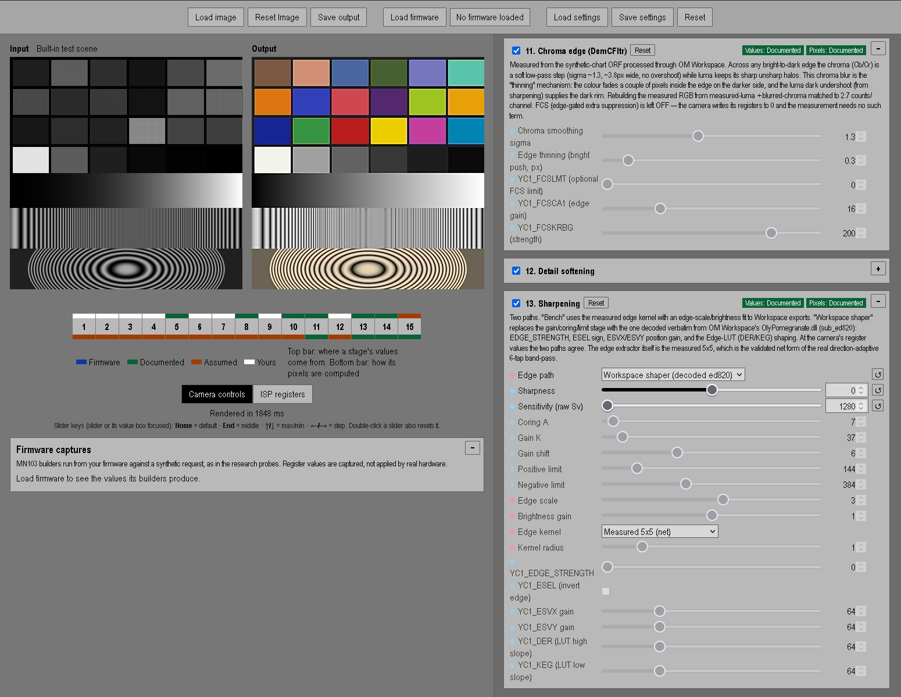

# olyom-isp-bench

A browser-based bench that emulates the image-signal-processing (ISP) steps of Olympus / OM Digital
cameras (PEN-F and close relatives). It lets you watch how each stage shapes the picture and study how
far the sharpening / edge enhancement can be pushed within the hardware's constraints.



The main focus is the **sharpening / edge enhancement** path — to see how much the sharpening could be
improved given the hardware constraints. Colour and tone are modelled too, but they have not been checked
for accuracy as thoroughly, so treat those stages as approximate.

Concept implemented with Claude Code.

Inspired by and built on the **OM-EMU** project: <https://github.com/flatpanda/om-emu>

Built on the research by:
- <https://github.com/fishcu/oly_fw_analysis>
- <https://github.com/cakelesscoder/caduceus-ep7>

## Using the bench

Open `dist/index.html` in any modern browser — no server or build step is needed to run it.

**Input image.** Load a **400×400 px `.PNG` crop of raw Bayer data**. You can produce one in RawTherapee or
DarkTable with demosaicing turned off (mono). Make sure no sharpening was applied to that raw data, so it
does not pollute the output. With no image loaded the bench shows a built-in synthetic test scene.

**CFA pattern.** If colours look inverted on import, pick a different *CFA Pattern* under parameter 1.

**Firmware (optional).** *Load firmware* runs the camera's own parameter builders on the emulated MN103
core against a synthetic request, so stages marked *Firmware* show the values a real PEN-F 3.1 `.BIN`
produces. The firmware itself is proprietary and is **not** included — supply your own file.

**Keyboard.** With a sub-parameter selected (a magenta highlight appears), the arrow keys and two extras act
on it: **←/→** decrease / increase the value by one step, **↑/↓** set it to maximum / minimum, **End** sets
the middle value, and **Home** restores the default. These work whether the slider or its value box has
focus; double-clicking a slider also resets it.

**Reachability bullets.** Each sub-parameter has a coloured dot by its heading:
-  **light blue** — firmware-reachable (a real camera menu setting or an ISP register the firmware writes).
-  **pink** — *not* firmware-reachable (a bench stand-in, or a value fixed by the camera hardware / picture mode).

The *Camera controls* / *ISP registers* switch chooses which of those a stage is editing: e.g. in the colour
profile (parameter 8) only saturation is editable under *Camera controls*, while hue and lightness — opened up
by the custom-firmware projects — become editable under *ISP registers*.

**Display.** The interface is designed for a monitor at least **1280 px wide**, so the parameters sit to the
right of the input / output images instead of below them.

## How it works

- `src/native.js` runs the PEN-F 3.1 builders on om-emu's unmodified MN103 core (`vendor/om-emu`), using the
  call fixtures from oly_fw_analysis's probes.
- `src/params.js` turns the sliders into pipeline values and records where each value came from.
- `src/pipeline.js` is the software ISP.

The camera's ISP hardware is not emulated. Stage labels in the page say which values and pixel operations come
from firmware, from the research documents, or from assumption.

The sharpening stage has two edge paths. **Bench** uses the measured 5×5 kernel with an edge-scale / brightness
fit to Workspace exports. **Workspace shaper** replaces the gain / coring / limit stage with `wsGain` /
`sharpenEdgeWS` in `src/pipeline.js`, decoded verbatim from OM Workspace's `OlyPomegranate.dll`
(`sub_1800ed820`): EDGE_STRENGTH, the ESEL edge-sign flip, ESVX/ESVY position gains, ECLP/ECLN limits and
KEDGE/coring, plus the `edgeLut` DER/KEG curve decoded from `sub_1800db8e0`. Verified: at the camera's register
values both paths produce identical shaper output, and `wsGain` reduces to `gain = KEDGE` exactly. Not verified
by execution (read from static disassembly, not run): the edge extractor is the measured 5×5, which is the
validated net form of the real direction-adaptive 6-tap `[-1,-1,4,4,-1,-1]` band-pass; the
band-pass-to-shaper normalisation (`WS_NORM`) and the register-to-knee mapping of the Edge LUT are not
recovered, so those carry the measured scale and a single inferred knee.

## Build & test

```sh
node build.mjs      # bundle src/ into dist/index.html (needs esbuild; set ESBUILD to its path)
node test/run.mjs   # run the tests
```

`test/make-fake-fw.mjs` builds the synthetic firmware the tests use. `test/realfw.mjs <firmware.BIN>` prints
every builder's output for a real PEN-F 3.1 file, and `test/amaze-compare.mjs` compares the AMaZE port with
the original compiled from source.

## Credits

- **OM-EMU** — flatpanda — the MN10300 / MN103 (AM33) emulator core this project builds on (`vendor/om-emu`).
- **oly_fw_analysis** — fishcu — firmware probe research and the builder call fixtures (Apache-2.0).
- **caduceus-ep7** — cakelesscoder — E-P7 sharpening / edge-handling firmware research (Apache-2.0).
- **AMaZE demosaic** — Emil Martinec and Ingo Weyrich, from RawTherapee; `src/amaze.js` is a JavaScript port
  (GPL-3.0-or-later).
- **Malvar-He-Cutler** demosaic — a published public algorithm, used as one of the selectable methods.
- **dpreview.com** — sample / studio-scene images used as test inputs during development.
- **OM Workspace** (`OlyPomegranate.dll`) and the **Olympus / OM camera firmware** are proprietary and are
  **not** redistributed here; only the behaviour of specific routines was documented and re-implemented for
  study.

## License

This project as a whole is distributed under the **GNU General Public License v3.0 or later**, because it
includes a port of RawTherapee's AMaZE (GPL-3.0-or-later). The full text is in [`LICENSE`](LICENSE).

The Apache-2.0 components — the builder call fixtures derived from `oly_fw_analysis` and anything taken from
`caduceus-ep7` — are compatible with GPLv3 and retain their own Apache-2.0 licence and attribution; keep their
`NOTICE` where their terms require it.

Not affiliated with OM Digital Solutions or Olympus. "Olympus", "PEN" and film-simulation names are trademarks
of their respective owners.
